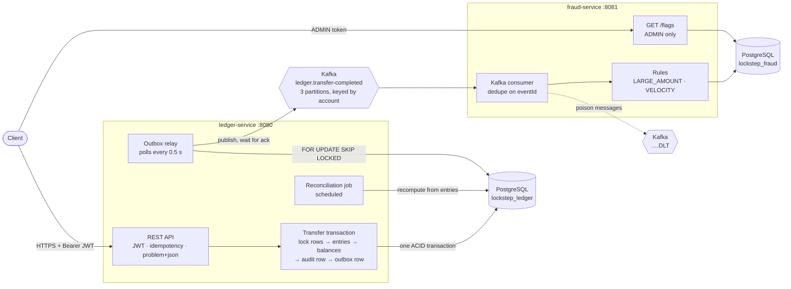
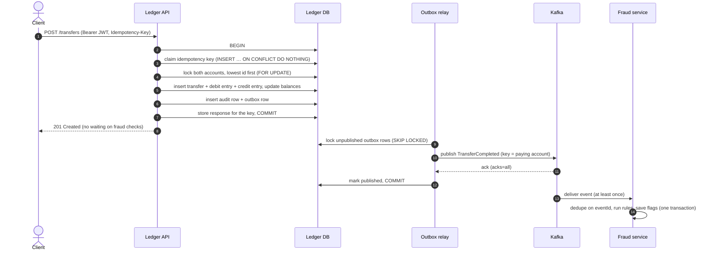

# Lockstep

[](https://github.com/gill-amitoj/Lockstep/actions/workflows/ci.yml)

A double-entry payments ledger and a separate, event-driven fraud-check service, built with Java 21 and Spring Boot. Its focus is on getting the hard parts of moving money right: atomic double-entry bookkeeping, idempotent APIs, row locking under concurrency, an append-only audit trail, reconciliation, and reliable event delivery between services through a transactional outbox.

## What it does

**Ledger service** (`ledger-service`, port 8080)
- **Double-entry bookkeeping.** Every transfer writes one debit and one credit entry in a single database transaction. Money is stored as `long` cents (CAD) and never as floating point. Each account's balance always equals the sum of its entries, and the entries of every transfer sum to zero.
- **Idempotent transfers.** `POST /transfers` requires an `Idempotency-Key`. A retry with the same key and body returns the original response. The same key with a different body returns `422`. Concurrent requests with one key create exactly one transfer, enforced by a primary key.
- **Safe under concurrency.** Both account rows are locked with `SELECT … FOR UPDATE`, always lowest id first. This prevents lost updates and deadlocks.
- **Security.** JWT login, with `CUSTOMER` (own accounts only) and `ADMIN` roles. Secrets come only from environment variables.
- **Audit log.** An append-only record of who did what and when. Database triggers block `UPDATE`, `DELETE` and `TRUNCATE`.
- **Reconciliation.** A scheduled job recomputes every balance from the entries, checks each transfer's entries, and records any mismatch.
- **Errors and logs.** Every error is RFC 9457 `application/problem+json`. Logs are structured JSON with a correlation id on every request.

**Fraud service** (`fraud-service`, port 8081)
- Consumes `TransferCompleted` events from Kafka and **deduplicates on event id**.
- Flags a transfer when **(a)** its amount is more than 5× the account's average, or **(b)** it is more than the 5th transfer from one account within 10 minutes.
- Exposes `GET /flags` (ADMIN only). Flagging is asynchronous and never blocks or slows a transfer.

## Architecture



The two services share **nothing but the Kafka topic**. Each has its own database, and neither calls the other. If the fraud service is down, transfers carry on, and it catches up from Kafka when it returns.

### A transfer, step by step



## Tech stack

Java 21 · Spring Boot 4.2 (Web MVC, Data JPA, Security, Kafka) · PostgreSQL 17 · Flyway · Apache Kafka 4.1 (KRaft) · springdoc-openapi · JUnit 5 · Testcontainers · Docker Compose · GitHub Actions · Gradle

## Run it locally

**Prerequisites:** JDK 21 or newer and Docker (Docker Desktop on macOS or Windows). Nothing else; Gradle comes from the wrapper.

### 1. Configure

```bash
cp .env.example .env
```

Then edit `.env`:
- `DB_PASSWORD`: any value.
- `JWT_SECRET`: at least 32 bytes. Generate one with `openssl rand -base64 48`.
- `ADMIN_PASSWORD`: at least 12 characters. The admin user is created at startup.

`.env` is git-ignored. Neither service starts without a valid `JWT_SECRET`.

### 2a. Everything in Docker (simplest)

```bash
./gradlew bootJar                                # build both services' jars
docker compose --profile apps up -d --build      # Postgres, Kafka, ledger, fraud
```

### 2b. Infrastructure in Docker, services from Gradle (for development)

```bash
docker compose up -d                             # Postgres + Kafka only
set -a; source .env; set +a                      # export the .env values
./gradlew :ledger-service:bootRun                # terminal 1
./gradlew :fraud-service:bootRun                 # terminal 2
```

For plain-text logs instead of JSON while developing, run with `LOG_FORMAT=` (empty).

### 3. See it work

```bash
./scripts/demo.sh
```

The demo signs up two customers, deposits money, shows an idempotent retry being replayed, an overdraft being rejected and an ownership check being enforced, then triggers both fraud rules, runs reconciliation and prints the audit trail. It needs `curl` and `python3`.

### 4. Explore the API

- Ledger: http://localhost:8080/swagger-ui.html
- Fraud: http://localhost:8081/swagger-ui.html

Get a token with `POST /auth/token`, click **Authorize**, and paste the `access_token`. The raw OpenAPI specs are at `/v3/api-docs` on each service.

### Stop

```bash
docker compose --profile apps down        # keep data
docker compose --profile apps down -v     # also delete the database volume
```

## API at a glance

| Method | Path | Who | Purpose |
|---|---|---|---|
| POST | `/auth/register` | anyone | Create a CUSTOMER user |
| POST | `/auth/token` | anyone | Log in, get a JWT |
| POST | `/accounts` | CUSTOMER | Open an account (owned by the caller) |
| GET | `/accounts` | any | Your accounts (admins: all) |
| GET | `/accounts/{id}` · `/accounts/{id}/entries` | owner, ADMIN | Balance · statement |
| POST | `/transfers` | owner of source account, ADMIN | Move money (`Idempotency-Key` required) |
| GET | `/transfers/{id}` | either party, ADMIN | One transfer |
| GET | `/admin/audit-events` | ADMIN | Audit log, newest first |
| POST · GET | `/admin/reconciliation-runs` | ADMIN | Run reconciliation now · list runs |
| GET | `/flags` (fraud service) | ADMIN | Fraud flags, optionally `?accountId=` |

Deposits are ordinary transfers from the bank's `SYSTEM` funding account, which only an admin can use. Every cent therefore has a matching entry, and the sum of all balances is always zero.

## Testing

Every test runs against **real PostgreSQL and Kafka in Docker** (Testcontainers). There are no mocks and no H2.

```bash
./gradlew test                       # everything (Docker must be running)
./gradlew :ledger-service:test       # one module
./gradlew :e2e-tests:test            # cross-service tests only
```

| Module | What the tests prove |
|---|---|
| `ledger-service` | Double-entry invariants; validation; DB constraints and append-only triggers; idempotency, including concurrent requests with one key; **concurrency** (hundreds of transfers fired at once from many threads: money conserved, no negative balance, no lost updates, no deadlocks); JWT, with forged, expired and wrong-issuer tokens rejected; ownership rules; audit trail; reconciliation catching deliberate corruption; correlation ids; problem+json; outbox atomicity, including a **paused Kafka broker** |
| `fraud-service` | Both rules and their boundaries; deduplication of redelivered events; poison messages dead-lettered without blocking later ones; `/flags` security |
| `e2e-tests` | Both services as **Docker containers built from their Dockerfiles**: suspicious transfers are flagged asynchronously, with one correlation id traced across both services; and **no event is lost** when the fraud service is down, Kafka is paused and the ledger is killed with `SIGKILL` |

Key concurrency and reliability tests were checked by temporarily breaking the code they protect and confirming they fail. That covers removing the row lock, locking in the wrong order, and disabling the idempotency claim.

CI runs the full suite on every push and pull request on a real JDK 21, and writes a per-module test count to the run summary.

### Measuring it yourself

```bash
# Total number of tests that ran
./gradlew test --rerun-tasks && cat */build/test-results/test/*.xml \
  | grep -o '<testsuite [^>]*' | grep -o ' tests="[0-9]*"' | grep -o '[0-9]*' | paste -sd+ - | bc

# What the concurrency test actually did on this run
./gradlew :ledger-service:test --rerun-tasks --tests '*ConcurrentTransferTest' -i | grep 'Concurrent transfers:'

# See the row-locking SQL Hibernate sends
SPRING_JPA_SHOW_SQL=true ./gradlew :ledger-service:test --rerun-tasks \
  --tests '*TransferServiceTest.transferMovesMoney*' -i | grep 'Hibernate:'
```

## Design decisions and trade-offs

- **The balance is stored, and also derivable.** `accounts.balance_cents` makes reads cheap, and the entries remain the source of truth. Reconciliation proves the two agree and never auto-corrects, because a mismatch is evidence for a person to investigate.
- **Pessimistic locking over optimistic.** A few heavily contended accounts would make `@Version` retries constant. Locking the lowest id first gives one global lock order, so deadlock cycles can't form. Ownership is checked by reading only the owner column, *before* locking. Loading the entity first would make Hibernate return a stale cached copy after the lock, which the tests showed re-introduces lost updates.
- **Idempotency through the database.** `INSERT … ON CONFLICT DO NOTHING` on a primary key makes a concurrent duplicate *wait* for the first request, then replay its response, with no locks in Java. Failed requests aren't stored, so a client can retry them with the same key.
- **Transactional outbox, not a dual write.** No transaction spans PostgreSQL and Kafka. The event is written with the transfer, and a relay publishes it, waiting for the broker's ack. Delivery is at least once, and the consumer's dedupe table makes the effect exactly once.
- **Event time, not processing time.** The fraud rules look back from when the transfer happened, so a replay after an outage gives the same answers.
- **Not-yours is a 404, not a 403,** so account ids can't be discovered by probing.
- **Known limits.** HS256 shares one signing secret between the services (production would use RS256 or an identity provider). There is no login rate limiting. The relay holds a DB transaction while waiting for Kafka (change-data-capture such as Debezium would scale further). Old outbox rows aren't pruned. Locally, both services share one database user.

## Project layout

```
ledger-service/   Spring Boot app: ledger, auth, audit, reconciliation, outbox
  src/main/resources/db/migration/   Flyway migrations V1 to V6 (the schema, with comments)
fraud-service/    Spring Boot app: Kafka consumer, rules, /flags
e2e-tests/        Cross-service tests (both services as containers)
docker/           Postgres init script (creates the fraud database)
scripts/demo.sh   Scripted walkthrough
.github/workflows/ci.yml
```

## Configuration

| Variable | Used by | Purpose |
|---|---|---|
| `DB_URL` | ledger | JDBC URL (default `jdbc:postgresql://localhost:5432/lockstep_ledger`) |
| `FRAUD_DB_URL` | fraud | JDBC URL (default `…/lockstep_fraud`) |
| `DB_USERNAME`, `DB_PASSWORD` | both, Compose | Database credentials (required) |
| `JWT_SECRET` | both | HS256 key, at least 32 bytes (required) |
| `ADMIN_USERNAME`, `ADMIN_PASSWORD` | ledger | First admin, created at startup if both are set |
| `KAFKA_BOOTSTRAP_SERVERS` | both | Default `localhost:9092` |
| `RECONCILIATION_INTERVAL` | ledger | ISO-8601 duration, default `PT1H` |
| `LOG_FORMAT` | both | `ecs` (JSON, default) or empty for plain text |

## License

MIT. See [LICENSE](LICENSE).
